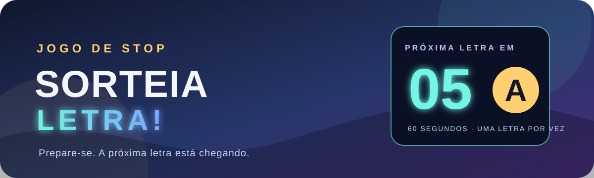
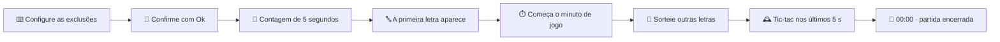

  

<h1 align="center">🎲 Sorteia Letra — STOP</h1>

  Um sorteador de letras para deixar as rodadas de STOP mais rápidas, animadas e imprevisíveis.

  🌈 <strong>Personalize as exclusões</strong> · ⏱️ <strong>Jogue por 1 minuto</strong> · 🔊 <strong>Entre no clima com sons</strong>

## ✨ O que tem no jogo

- **Exclusões personalizáveis:** K, W e Y começam preenchidas. Edite o campo para excluir outras letras ou apague tudo para permitir o alfabeto inteiro.
- **Entrada organizada:** o campo aceita somente letras de A a Z, converte para maiúsculas e remove repetições quando você confirma.
- **Sorteio animado:** uma contagem regressiva de cinco segundos anuncia cada letra, que surge girando nos três eixos.
- **Relógio de partida:** o minuto começa depois que a primeira letra aparece — não durante a preparação inicial.
- **Áudio sintetizado:** há uma fanfarra no início, sinais durante as contagens, tic-tac nos últimos cinco segundos e um alerta marcante no fim.
- **Acompanhamento visual:** confira o histórico, a lista de exclusões e o alfabeto; letras indisponíveis aparecem apagadas.

## 🚀 Como jogar

1. Abra [`STOP_Sorteia_Letra.html`](./STOP_Sorteia_Letra.html) em um navegador moderno. Não é necessário instalar dependências nem iniciar um servidor.
2. Na tela de preparação, revise o campo **“Digite as letras que não devem ser sorteadas”**. Ele começa com `KWY`.
   - Para incluir uma letra nas opções, apague-a do campo.
   - Para excluir mais letras, digite-as no mesmo campo.
   - Maiúsculas e minúsculas são aceitas; a tela sempre mostra letras maiúsculas.
   - Números, espaços, pontuação e caracteres fora de A–Z são descartados.
3. Clique em **Ok**. Letras repetidas são consolidadas; por exemplo, `kKwYy` fica `KWY`.
4. A contagem inicial prepara a primeira letra. **O relógio de 01:00 só começa quando essa letra é revelada.**
5. Depois que cada letra aparece, clique em **Sortear outra letra** para continuar. O botão permanece disponível durante a contagem; se clicar antes da revelação, a contagem de cinco segundos recomeça.
6. Observe o relógio e o tic-tac final. Ao chegar a `00:00`, a partida termina e o alerta sonoro toca. Clique em **Sortear outra letra** para iniciar outro sorteio e reiniciar o relógio; o histórico é mantido.

> **Quer liberar todas as letras?** Deixe o campo de exclusões vazio antes de clicar em **Ok**. Se todas as 26 letras forem excluídas, o jogo pede que você deixe pelo menos uma disponível.

## 🧭 Uma rodada, passo a passo

## 🔊 Sobre os sons

Os efeitos são gerados pelo próprio navegador com **Web Audio API**; o projeto não carrega arquivos de áudio nem depende de serviços externos. Clique em **Ok** para iniciar o áudio. Se não ouvir os efeitos, confira o volume do dispositivo e se o navegador permite reprodução de áudio.

## 🧰 Arquivos do projeto

| Arquivo | Para que serve |
| --- | --- |
| [`STOP_Sorteia_Letra.html`](./STOP_Sorteia_Letra.html) | Interface, estilos e controles do jogo |
| [`STOP-SorteiaLetra.js`](./STOP-SorteiaLetra.js) | Sorteio, contagem, sons, exclusões e histórico |
| [`banner-stop-sorteio.svg`](./banner-stop-sorteio.svg) | Ilustração de capa deste guia |

## 🏷️ Versão

**1.1** — animação 3D nos três eixos, botão de sorteio sempre disponível e novo crédito visual.
